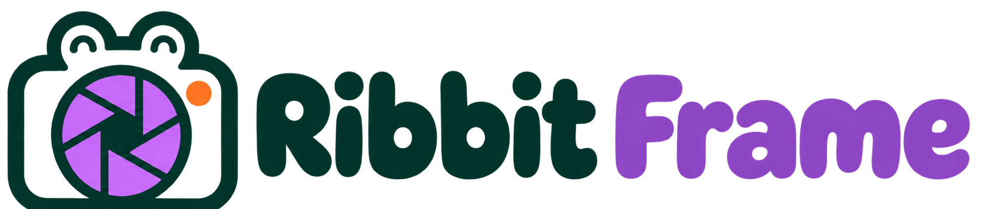

<div align="center">



# Ribbit Frame

**Sua biblioteca de mídias, pronta para a próxima edição.**

Organize arquivos locais, encontre o que precisa e sorteie imagens, vídeos e áudios em um aplicativo para Windows.

[Baixar versão mais recente](https://github.com/NunesNicolas/ribbit-frame/releases/latest) · [Funcionalidades](#o-que-dá-para-fazer) · [Direitos autorais](COPYRIGHT.md)

</div>

## Baixar e instalar

Na página de [Releases](https://github.com/NunesNicolas/ribbit-frame/releases/latest), escolha:

| Arquivo | Como usar |
| --- | --- |
| `Ribbit-Frame-Setup-<versão>.exe` | Baixe, execute o instalador e abra o atalho criado no Windows. |
| `Ribbit-Frame-Portable-<versão>.zip` | Extraia o ZIP inteiro e execute `Ribbit Frame.exe` dentro da pasta extraída. |

O aplicativo é distribuído para **Windows 10/11, 64 bits**. Quem instala a versão pronta não precisa de Node.js, Python, Docker ou Rust. O instalador ainda não possui assinatura digital; o Windows pode exibir um aviso do SmartScreen. Confira se o download veio da página de Releases deste repositório.

## O que dá para fazer

| Área | Recursos |
| --- | --- |
| **Explorar** | Vincular pastas sem copiar seus arquivos, importar mídias avulsas, visualizar, pesquisar, filtrar e ordenar. |
| **Catalogar** | Atribuir pessoas, categorias e várias tags, inclusive a uma seleção de arquivos. |
| **Sortear** | Encontrar uma mídia aleatória dentro dos filtros escolhidos. |
| **Copiar** | Copiar imagens para a área de transferência; para áudio e vídeo, copiar o caminho local. |
| **YouTube** | Consultar formatos e baixar vídeo ou áudio para uma pasta escolhida. |
| **Buscar imagens** | Pesquisar imagens da web, incluindo resultados do Pinterest, e salvar no catálogo. |
| **Efeitos sonoros** | Pesquisar, ouvir e salvar sons do MyInstants. |
| **Legendas** | Transcrever mídia local com Faster-Whisper e exportar SRT, VTT ou JSON. |

> **Direitos das mídias:** encontrar ou baixar um arquivo não concede permissão para usá-lo em um vídeo publicado. Consulte [direitos autorais e avisos de terceiros](COPYRIGHT.md) antes de redistribuir conteúdo.

### Comece por aqui

1. Abra **Explorar arquivos** e vincule uma pasta com suas mídias. O app lê os arquivos no local original.
2. Selecione arquivos e use **Catalogar** para adicionar pessoa, categoria e tags.
3. Use os filtros do explorador ou o painel de **Sorteio** para localizar uma mídia.
4. Abra a prévia e copie a imagem ou o caminho do arquivo para seu fluxo de edição.

Arquivos importados individualmente e downloads são armazenados nos dados do aplicativo. A pasta padrão aparece como **Local**; ela reúne mídias importadas e downloads. Pastas vinculadas continuam no lugar de origem. Se você mover uma pasta vinculada, o app pode deixar de encontrar seus arquivos.

Em **Configurações > Pastas catalogadas**, você pode desvincular uma pasta. Os arquivos originais permanecem no disco, mas as classificações dos itens dessa pasta saem do catálogo.

## Atualizações e dados

O Ribbit Frame verifica se há uma nova release ao iniciar a versão instalada. A instalação da atualização começa **somente quando você clica** em **Instalar atualização**. Também é possível baixar a release mais recente pelo link acima.

O catálogo e os arquivos gerenciados pelo app ficam em `%APPDATA%\foreditor`. O instalador preserva esses dados durante atualizações e desinstalações. Faça uma cópia dessa pasta antes de trocar de computador ou limpar os dados do aplicativo. A integração de backup com Google Drive ainda não está implementada.

Na primeira utilização de certos recursos, o app obtém ferramentas e modelos necessários, como yt-dlp, um runtime Node.js para o YouTube, FFmpeg e o modelo de transcrição. Essas operações exigem conexão e espaço em disco. A transcrição em `large-v3-turbo` funciona localmente após a preparação inicial e pode consumir bastante RAM.

## Desenvolver localmente

Requisitos: Windows, Node.js 22+ e npm.

```powershell
npm ci
npm start
```

`npm start` abre a interface React/Vite no Electron. `npm run dev` inicia apenas a interface no navegador; recursos que dependem de arquivos locais, downloads e integração nativa exigem Electron. A biblioteca do navegador é separada da biblioteca do aplicativo.

Para gerar o instalador no Windows:

```powershell
npm run dist
```

O resultado fica em `release/`. O workflow em `.github/workflows/release-windows.yml` gera e publica o instalador e o ZIP a cada atualização da branch `main`.

## Limites conhecidos

- Copiar pixels de uma imagem pode funcionar em editores gráficos, mas **colar diretamente como clipe no Adobe Premiere Pro não foi validado**.
- Áudio e vídeo copiam o caminho local; a importação no editor depende do programa usado.
- Busca na web e downloads dependem dos serviços de origem e podem parar de funcionar se eles alterarem páginas, formatos ou regras.
- O aplicativo não oferece hoje sincronização ou backup no Google Drive.

## Créditos e direitos

O código e os elementos originais do Ribbit Frame têm seus direitos reservados conforme [COPYRIGHT.md](COPYRIGHT.md). As licenças e obrigações das dependências são independentes dos direitos do projeto. Veja também [avisos de terceiros](THIRD_PARTY_NOTICES.md).

Ribbit Frame é um projeto independente, sem afiliação com Adobe, Google, YouTube, Pinterest ou MyInstants.
